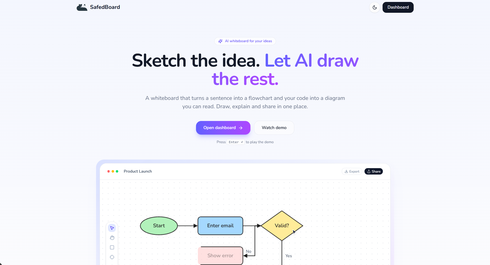
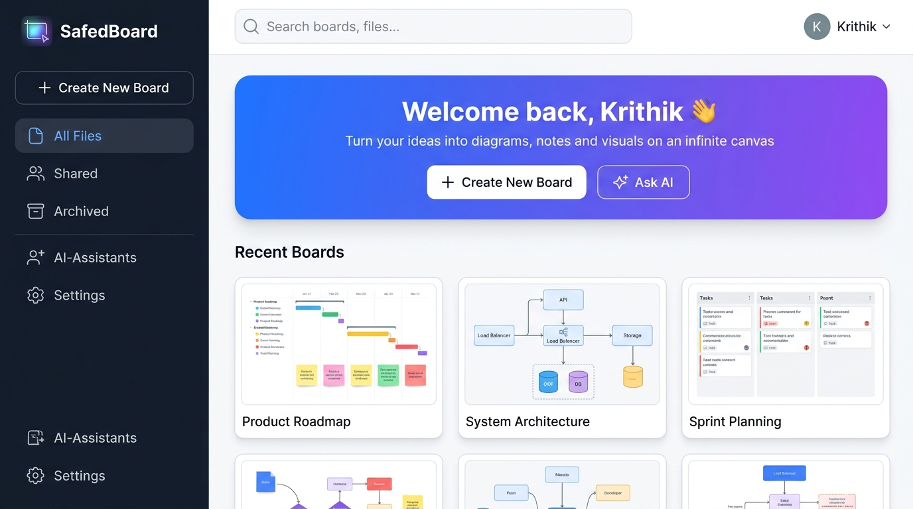
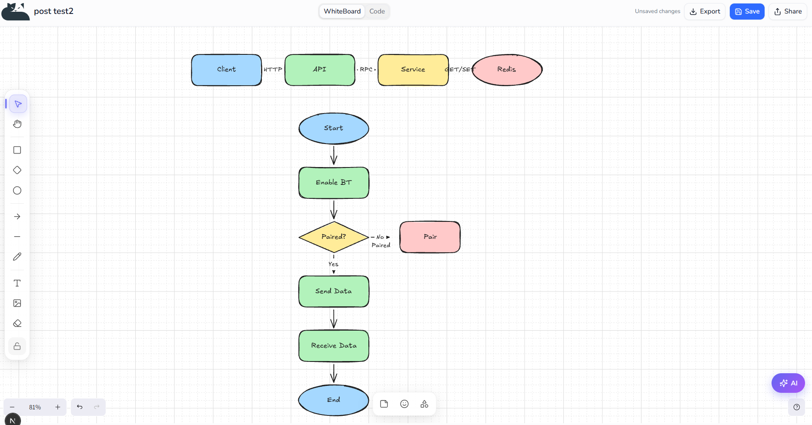

<!-- HERO BADGE -->


<br/><br/>

<!-- LOGO -->
<picture>
  <source media="(prefers-color-scheme: dark)" srcset="public/logo.svg">
  <source media="(prefers-color-scheme: light)" srcset="public/logo.svg">
  
</picture>

# 🎨 Agentic Whiteboard

### *Where ideas meet infinite canvas*

<br/>

[](https://nextjs.org/)
[](https://react.dev/)
[](https://www.typescriptlang.org/)
[](https://tailwindcss.com/)
[](https://clerk.com/)
[](https://neon.tech/)
[](https://orm.drizzle.team/)
[](https://excalidraw.com/)
[](https://console.groq.com/)
[-8E75B2?style=flat-square&logo=googlegemini&logoColor=white)](https://ai.google.dev/)

<br/>

**Agentic Whiteboard** is an AI whiteboard that turns a text prompt into a diagram on an infinite **Excalidraw** canvas. Describe a flowchart, architecture diagram, mind map or wireframe, and the AI draws it as editable shapes. You can also paste code and get a flowchart of it. Boards autosave to the cloud, show up as preview cards on your dashboard, and can be exported as an image or shared as a view-only link.

<br/>

🌐 **Live Demo:** `https://agentic-whiteboard.vercel.app`

<br/>

[🚀 Getting Started](#-quick-start) · [✨ Features](#-features) · [🏗️ Architecture](#%EF%B8%8F-architecture) · [📸 Screenshots](#-screenshots) · [🛠️ Tech Stack](#%EF%B8%8F-tech-stack) · [☁️ Deploy](#%EF%B8%8F-deploy-on-vercel) · [🤝 Contributing](#-contributing)

---

</div>

<br/>

## 📸 Screenshots

<div align="center">

### 🏠 Landing Page

> *Landing page with an animated demo of the AI drawing a flowchart*



<br/><br/>

### 📊 Dashboard

> *Your boards as preview cards, sidebar navigation and the monthly AI credits bar*



<br/><br/>

### 🎨 Whiteboard Canvas

> *Excalidraw-powered infinite canvas with a custom toolbar*



</div>

<br/>

---

## ✨ Features

<table>
<tr>
<td width="50%">

### 🤖 AI Diagram Generation
Write a prompt and pick a type: **Flowchart, Architecture Diagram, Mind Map, Web Wireframe** or **Mobile Wireframe**. The AI returns shapes that are drawn on the canvas as normal, editable Excalidraw elements. Arrows are routed by code so they don't cut through boxes.

</td>
<td width="50%">

### 💻 Code → Flowchart
Open the **Code** tab, paste code (up to 200 lines), and the AI turns it into a Mermaid flowchart that is drawn on the whiteboard. Click a step to highlight the matching lines of code.

</td>
</tr>
<tr>
<td width="50%">

### 🖊️ Infinite Canvas
Draw with **Excalidraw**: rectangles, diamonds, ellipses, arrows, freehand, text. Custom left toolbar with tool lock, a bottom dock for notes, emojis and icons, and a floating properties bar on selected elements (colors, stroke, font, opacity, duplicate, front/back, lock, delete).

</td>
<td width="50%">

### ☁️ Autosave + Save
The canvas (elements, app state, files) is saved to **Neon PostgreSQL** after you stop editing (10 seconds by default, 5 / 10 / 30 in Settings). A **Save** button and `Ctrl+S` save right away, and the header shows saved / unsaved status.

</td>
</tr>
<tr>
<td width="50%">

### 📁 Project Dashboard
All your boards in a grid of **preview cards** (a small JPEG of the canvas, made on every save) with "Edited … ago" time. Create new boards, open, archive or delete them.

</td>
<td width="50%">

### 🗄️ Archive & Restore
Archive a board to hide it from the dashboard. The **Archived** page lets you restore it or delete it for good.

</td>
</tr>
<tr>
<td width="50%">

### 🪙 AI Credits
Each user gets **10 AI credits per month**, refilled on the 1st (UTC). Every AI generation uses 1 credit, and the credit is refunded if the AI fails. No limit on the number of boards.

</td>
<td width="50%">

### 🖼️ Export as Image
Download the whole board as a **PNG** from the workspace header.

</td>
</tr>
<tr>
<td width="50%">

### 🔗 Share (View-only)
Turn on sharing to get a public link. Anyone with the link can view the board (read only, no login). The **Shared by me** page lists your shared boards.

</td>
<td width="50%">

### 🔐 Authentication
Sign in / sign up with **Clerk**. Social logins (Google, GitHub, …) can be turned on from the Clerk dashboard, no code change needed.

</td>
</tr>
<tr>
<td width="50%">

### 🌙 Dark Mode & Settings
Light / dark theme for the app, a separate canvas theme, text size, font, grid and autosave interval. Settings are saved in your browser.

</td>
<td width="50%">

### 🔁 AI Fallback
**Groq** is the main AI provider and **Gemini** is the fallback. If Groq is rate limited or down (429 / 500 / 503), the request is tried once on Gemini.

</td>
</tr>
</table>

<br/>

---

## 🏗️ Architecture

```
┌──────────────────────────────────────────────────────────────────┐
│                        AGENTIC WHITEBOARD                        │
├──────────────────────────────────────────────────────────────────┤
│                                                                  │
│  ┌──────────┐   ┌──────────────┐   ┌──────────────────────────┐  │
│  │  Clerk   │   │   Next.js    │   │  Excalidraw Canvas       │  │
│  │  Auth    ├──▶│   App Router ├──▶│  + Custom Toolbar        │  │
│  │          │   │   (React 19) │   │  + AI Sidebar / Code tab │  │
│  └──────────┘   └──────┬───────┘   │  + mermaid-to-excalidraw │  │
│                        │           └──────────────────────────┘  │
│                        ▼                                         │
│          ┌───────────────────────────┐                           │
│          │        API Routes         │                           │
│          │  /api/user                │                           │
│          │  /api/projects            │                           │
│          │  /api/projects/share      │                           │
│          │  /api/projects/archived   │                           │
│          │  /api/whiteboard          │                           │
│          │  /api/share   (public)    │                           │
│          │  /api/ai                  ├──────┐                    │
│          │  /api/ai/code             │      │                    │
│          └─────────────┬─────────────┘      ▼                    │
│                        │          ┌──────────────────────┐       │
│                        │          │  AI Providers        │       │
│                        │          │  Groq (primary)      │       │
│                        │          │  Gemini (fallback)   │       │
│                        ▼          └──────────────────────┘       │
│              ┌──────────────────┐                                │
│              │   Drizzle ORM    │                                │
│              │   + Neon DB      │                                │
│              │   (PostgreSQL)   │                                │
│              └──────────────────┘                                │
│                                                                  │
└──────────────────────────────────────────────────────────────────┘
```

<br/>

---

## 🛠️ Tech Stack

| Layer | Technology | Purpose |
|:------|:-----------|:--------|
| **Framework** | Next.js 16 (App Router) | Full-stack React framework with server components |
| **Frontend** | React 19, TypeScript | Type-safe UI with latest React features |
| **Styling** | Tailwind CSS v4, shadcn/ui | Utility-first CSS with prebuilt accessible components |
| **Canvas** | Excalidraw, @excalidraw/mermaid-to-excalidraw | Hand-drawn style infinite whiteboard, Mermaid → shapes |
| **AI** | Groq (primary), Gemini via `@google/genai` (fallback) | Diagram and code-flowchart generation with JSON schema output |
| **Auth** | Clerk | Complete user management & authentication |
| **Database** | Neon (Serverless PostgreSQL) | Auto-scaling cloud Postgres |
| **ORM** | Drizzle ORM | Type-safe SQL queries & schema push |
| **UI Extras** | Lucide Icons, Base UI, next-themes, date-fns, Axios | Icons, headless primitives, theming, dates, API calls |

<br/>

---

## 🚀 Quick Start

### Prerequisites

- **Node.js** ≥ 20.9 (required by Next.js 16)
- **npm**
- A [Clerk](https://clerk.com) account
- A [Neon](https://neon.tech) database
- A [Groq](https://console.groq.com) API key and/or a [Google AI Studio](https://aistudio.google.com) API key

### 1️⃣ Clone & Install

```bash
git clone <your-repo-url>
cd Agentic-AI-whiteboard
npm install
```

### 2️⃣ Environment Setup

```bash
cp .env.example .env
```

Fill in your own values in `.env`:

| Variable | What it is for |
|:---------|:---------------|
| `NEXT_PUBLIC_APP_URL` | Base URL of the app (e.g. localhost in development) |
| `DATABASE_URL` | Neon Postgres connection string |
| `NEXT_PUBLIC_CLERK_PUBLISHABLE_KEY` | Clerk publishable key (browser) |
| `CLERK_SECRET_KEY` | Clerk secret key (server) |
| `NEXT_PUBLIC_CLERK_SIGN_IN_URL` | Path of the sign-in page (`/sign-in`) |
| `NEXT_PUBLIC_CLERK_SIGN_UP_URL` | Path of the sign-up page (`/sign-up`) |
| `GROQ_API_KEY` | Groq API key (primary AI provider) |
| `GROQ_MODEL` | Groq model ID to use |
| `GOOGLE_API_KEY` | Gemini API key (fallback AI provider) |
| `GEMINI_MODEL` | Gemini model ID from AI Studio (the API ID, not the display name) |

> 🔑 **Gemini key:** sign in to [Google AI Studio](https://aistudio.google.com), open **Get API key**, create a key and paste it into `GOOGLE_API_KEY`.

> 💡 A provider is used only if both its key and model are set. You need at least one of Groq or Gemini for the AI features. Never commit `.env`.

### 3️⃣ Database

```bash
npm run db:push
```

### 4️⃣ Launch

```bash
npm run dev
```

Open [http://localhost:3000](http://localhost:3000) — you're live! 🎉

<br/>

---

## ☁️ Deploy on Vercel

1. Push the repo to GitHub and **import** it in [Vercel](https://vercel.com/new).
2. In **Project Settings → Environment Variables**, add every variable from the table above (use your production URL for `NEXT_PUBLIC_APP_URL`).
3. **Deploy.**
4. In the **Clerk dashboard**, add your Vercel domain (e.g. `your-app.vercel.app` or your custom domain) to the allowed domains / production instance, so sign-in works on the live site.
5. Make sure the Neon database schema is pushed (`npm run db:push` with the production `DATABASE_URL`).

<br/>

---

## 📂 Project Structure

```
Agentic-AI-whiteboard/
├── app/
│   ├── api/
│   │   ├── ai/route.ts               # AI diagram generation (uses 1 credit)
│   │   ├── ai/code/route.ts          # Code → Mermaid flowchart (uses 1 credit)
│   │   ├── projects/route.ts         # List, fetch, create, archive, delete boards
│   │   ├── projects/share/route.ts   # Turn view-only sharing on/off
│   │   ├── projects/archived/route.ts# Delete all archived boards
│   │   ├── share/route.ts            # Public read-only board data
│   │   ├── user/route.ts             # User sync + monthly credit refill
│   │   └── whiteboard/route.ts       # Canvas + preview image save
│   ├── dashboard/
│   │   ├── layout.tsx                # Sidebar + header shell
│   │   ├── page.tsx                  # Welcome banner + board grid
│   │   ├── archive/page.tsx          # Archived boards
│   │   ├── shared/page.tsx           # Boards shared by me
│   │   └── settings/page.tsx         # Settings
│   ├── workspace/
│   │   └── [projectid]/page.tsx      # Whiteboard / Code workspace
│   ├── share/[projectid]/page.tsx    # Public view-only board
│   ├── sign-in/ & sign-up/           # Clerk auth pages
│   ├── globals.css                   # Theme tokens & custom styles
│   ├── layout.tsx                    # Root layout with Clerk provider
│   ├── provider.tsx                  # Theme + user details provider
│   └── page.tsx                      # Landing page
├── components/
│   ├── custom/
│   │   ├── dashboard/                # Sidebar, header, project list, dialogs
│   │   ├── landing/                  # Landing page + animated demo board
│   │   ├── settings/                 # Settings page
│   │   ├── share/                    # Read-only share viewer
│   │   └── workspace/                # Whiteboard, AIFloatingSidebar, CodeFlow,
│   │                                 # FloatingProperties, ExtrasPanel,
│   │                                 # ShareDialog, WorkspaceHeader
│   └── ui/                           # shadcn/ui primitives
├── lib/
│   ├── aiProviders.ts                # Groq + Gemini calls with fallback
│   ├── aiTools.ts                    # AI diagram types and prompts
│   ├── codeFlow.ts                   # Code tab limits
│   ├── credits.ts                    # Spend / refund / refill AI credits
│   ├── plans.ts                      # Free plan: 10 AI credits per month
│   └── settings.ts, settingsBoot.ts  # Browser settings
├── db/
│   ├── schema.ts                     # Drizzle schema (users, Projects, WhiteBoardContent)
│   └── index.ts                      # Neon DB connection
├── context/                          # React context (user details)
├── hooks/                            # Shared hooks
├── proxy.ts                          # Clerk middleware (protects /dashboard)
└── public/
    ├── logo.svg
    └── screenshots/                  # README images
```

<br/>

---

## 🗄️ Database Schema

```
┌──────────────────────┐   ┌─────────────────────┐   ┌──────────────────────────┐
│        users         │   │      Projects       │   │    WhiteBoardContent     │
├──────────────────────┤   ├─────────────────────┤   ├──────────────────────────┤
│ id              (PK) │   │ id             (PK) │   │ id                  (PK) │
│ clerk_id        (UQ) │   │ project_id     (UQ) │◄──┤ project_id      (FK, UQ) │
│ name                 │   │ email               │   │ elements          (JSON) │
│ email                │   │ project_name        │   │ appState          (JSON) │
│ credits              │   │ is_deleted          │   │ files             (JSON) │
│ credits_reset_at     │   │ is_public           │   │ preview_image     (text) │
│ created_at           │   │ created_at          │   │ created_at               │
│                      │   │ updated_at          │   │ updated_at               │
└──────────────────────┘   └─────────────────────┘   └──────────────────────────┘
```

- `users.credits` — AI credits left this month, `credits_reset_at` — last refill time
- `Projects.email` — owner's email, `is_deleted` — archived, `is_public` — view-only link on
- `WhiteBoardContent.preview_image` — small base64 JPEG for the dashboard card

<br/>

---

## 📜 Available Scripts

| Command | Description |
|:--------|:------------|
| `npm run dev` | Start development server (Turbopack) |
| `npm run build` | Production build |
| `npm run start` | Start production server |
| `npm run db:push` | Push schema to database |
| `npm run db:studio` | Open Drizzle Studio GUI |
| `npm run db:generate` | Generate SQL migration files (optional, setup uses `db:push`) |

<br/>

---

## 🤝 Contributing

Contributions are welcome! Here's how:

1. **Fork** the repository
2. **Create** a feature branch: `git checkout -b feat/amazing-feature`
3. **Commit** your changes: `git commit -m 'feat: add amazing feature'`
4. **Push** to the branch: `git push origin feat/amazing-feature`
5. Open a **Pull Request**

<br/>

---

<div align="center">

<br/>

**Built with using Next.js, Excalidraw & AI**

<br/>

<sub>If you found this helpful, give it a ⭐ — it means the world!</sub>

<br/><br/>

</div>
