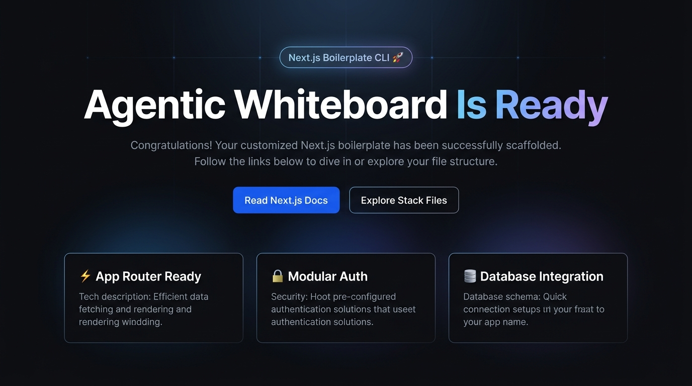
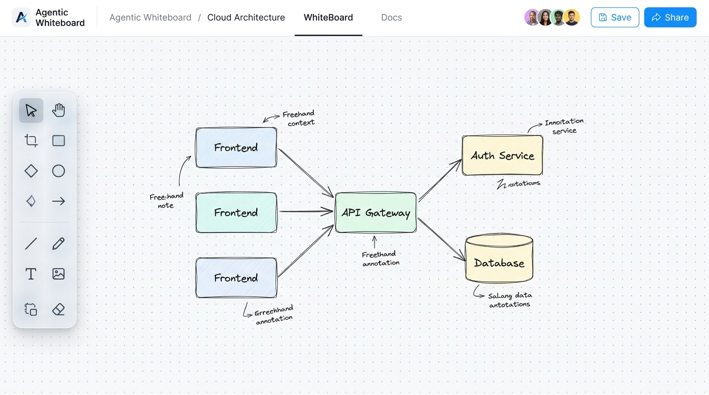

<div align="center">

<!-- HERO BADGE -->


<br/><br/>

<!-- LOGO -->
<picture>
  <source media="(prefers-color-scheme: dark)" srcset="public/logo.svg">
  <source media="(prefers-color-scheme: light)" srcset="public/logo.svg">
  
</picture>

# 🎨 Agentic Whiteboard

### *Where ideas meet infinite canvas*

<br/>

[](https://nextjs.org/)
[](https://react.dev/)
[](https://www.typescriptlang.org/)
[](https://tailwindcss.com/)
[](https://clerk.com/)
[](https://neon.tech/)
[](https://orm.drizzle.team/)
[](https://excalidraw.com/)

<br/>

**Agentic Whiteboard** is a collaborative platform for creating, sharing, and collaborating on digital whiteboards in real-time. Brainstorm, plan, and visualize ideas with team members on an infinite canvas — powered by AI.

<br/>

[🚀 Getting Started](#-quick-start) · [✨ Features](#-features) · [🏗️ Architecture](#%EF%B8%8F-architecture) · [📸 Screenshots](#-screenshots) · [🛠️ Tech Stack](#%EF%B8%8F-tech-stack) · [🤝 Contributing](#-contributing)

---

</div>

<br/>

## 📸 Screenshots

<div align="center">

### 🏠 Landing Page

> *Sleek dark-mode hero with gradient typography and feature highlights*



<br/><br/>

### 📊 Dashboard

> *Personalized workspace with project management, sidebar navigation, and AI assistant*


<br/><br/>

### 🎨 Whiteboard Canvas

> *Excalidraw-powered infinite canvas with a custom glassmorphism toolbar*



</div>

<br/>

---

## ✨ Features

<table>
<tr>
<td width="50%">

### 🖊️ Infinite Canvas
Draw, sketch, and diagram with **Excalidraw** integration. Rectangles, diamonds, ellipses, arrows, freehand drawing, text — all with a beautiful custom toolbar featuring hover effects and keyboard shortcuts.

</td>
<td width="50%">

### 🤖 AI-Powered Assistance
Built-in AI brainstorming assistant to help generate ideas, refine diagrams, and accelerate your creative workflow.

</td>
</tr>
<tr>
<td width="50%">

### 🔐 Secure Authentication
Powered by **Clerk** with modular auth, social logins, and secure session management out of the box.

</td>
<td width="50%">

### ☁️ Auto-Save to Cloud
Canvas state (elements, app state, files) automatically saves to **Neon PostgreSQL** with a debounced 10-second interval — never lose your work.

</td>
</tr>
<tr>
<td width="50%">

### 📁 Project Management
Create, organize, and manage multiple whiteboard projects from a sidebar dashboard with progress tracking and file quotas.

</td>
<td width="50%">

### 🌙 Dark Mode
Full light & dark theme support with carefully crafted color palettes and smooth transitions.

</td>
</tr>
</table>

<br/>

---

## 🏗️ Architecture

```
┌─────────────────────────────────────────────────────────────────┐
│                        AGENTIC WHITEBOARD                       │
├─────────────────────────────────────────────────────────────────┤
│                                                                 │
│  ┌──────────┐   ┌──────────────┐   ┌───────────────────────┐   │
│  │  Clerk   │   │   Next.js    │   │    Excalidraw         │   │
│  │  Auth    ├──▶│   App Router ├──▶│    Canvas Engine      │   │
│  │          │   │   (React 19) │   │    + Custom Toolbar   │   │
│  └──────────┘   └──────┬───────┘   └───────────────────────┘   │
│                        │                                        │
│                        ▼                                        │
│              ┌──────────────────┐                               │
│              │   API Routes     │                               │
│              │  /api/user       │                               │
│              │  /api/projects   │                               │
│              │  /api/whiteboard │                               │
│              └────────┬─────────┘                               │
│                       │                                         │
│                       ▼                                         │
│              ┌──────────────────┐                               │
│              │   Drizzle ORM    │                               │
│              │   + Neon DB      │                               │
│              │   (PostgreSQL)   │                               │
│              └──────────────────┘                               │
│                                                                 │
└─────────────────────────────────────────────────────────────────┘
```

<br/>

---

## 🛠️ Tech Stack

| Layer | Technology | Purpose |
|:------|:-----------|:--------|
| **Framework** | Next.js 16 (App Router) | Full-stack React framework with server components |
| **Frontend** | React 19, TypeScript | Type-safe UI with latest React features |
| **Styling** | Tailwind CSS v4, shadcn/ui | Utility-first CSS with prebuilt accessible components |
| **Canvas** | Excalidraw | Hand-drawn style infinite whiteboard |
| **Auth** | Clerk | Complete user management & authentication |
| **Database** | Neon (Serverless PostgreSQL) | Auto-scaling cloud Postgres |
| **ORM** | Drizzle ORM | Type-safe SQL queries & migrations |
| **UI Extras** | Lucide Icons, Radix UI, cmdk | Icon set, headless primitives, command palette |

<br/>

---

## 🚀 Quick Start

### Prerequisites

- **Node.js** ≥ 18
- **npm** or **pnpm**
- A [Clerk](https://clerk.com) account
- A [Neon](https://neon.tech) database

### 1️⃣ Clone & Install

```bash
git clone https://github.com/your-username/agentic-whiteboard.git
cd agentic-whiteboard
npm install
```

### 2️⃣ Environment Setup

```bash
cp .env.example .env
```

Fill in your credentials in `.env`:

```env
# Clerk
NEXT_PUBLIC_CLERK_PUBLISHABLE_KEY=pk_...
CLERK_SECRET_KEY=sk_...

# Neon Database
DATABASE_URL=postgresql://...
```

### 3️⃣ Database Migration

```bash
npm run db:generate
npm run db:push
```

### 4️⃣ Launch

```bash
npm run dev
```

Open [http://localhost:3000](http://localhost:3000) — you're live! 🎉

<br/>

---

## 📂 Project Structure

```
agentic-whiteboard/
├── app/
│   ├── api/
│   │   ├── projects/route.ts     # CRUD for whiteboard projects
│   │   ├── user/route.ts         # User sync endpoint
│   │   └── whiteboard/route.ts   # Canvas save/load endpoint
│   ├── dashboard/
│   │   ├── layout.tsx            # Sidebar + header shell
│   │   └── page.tsx              # Welcome banner + project grid
│   ├── workspace/
│   │   └── [projectid]/page.tsx  # Whiteboard/Docs workspace
│   ├── sign-in/ & sign-up/       # Clerk auth pages
│   ├── globals.css               # Theme tokens & custom styles
│   ├── layout.tsx                # Root layout with Clerk provider
│   └── page.tsx                  # Landing/hero page
├── components/
│   ├── custom/
│   │   ├── dashboard/            # Sidebar, header, project list, dialogs
│   │   └── workspace/            # Whiteboard, SmartDocx, header tabs
│   └── ui/                       # shadcn/ui primitives
├── db/
│   ├── schema.ts                 # Drizzle schema (users, projects, boards)
│   └── index.ts                  # Neon DB connection
├── context/                      # React context providers
└── public/
    ├── logo.svg
    └── screenshots/              # README images
```

<br/>

---

## 🗄️ Database Schema

```
┌──────────────┐     ┌─────────────────┐     ┌─────────────────────┐
│    users      │     │    Projects      │     │  WhiteBoardContent   │
├──────────────┤     ├─────────────────┤     ├─────────────────────┤
│ id       (PK)│     │ id          (PK)│     │ id             (PK) │
│ clerk_id (UQ)│     │ project_id  (UQ)│◄───▶│ project_id     (FK) │
│ name         │     │ email           │     │ elements       (JSON│
│ email        │     │ project_name    │     │ appState       (JSON│
│ credits      │     │ created_at      │     │ files          (JSON│
│ created_at   │     │ updated_at      │     │ created_at          │
└──────────────┘     └─────────────────┘     │ updated_at          │
                                              └─────────────────────┘
```

<br/>

---

## 📜 Available Scripts

| Command | Description |
|:--------|:------------|
| `npm run dev` | Start development server with Turbopack |
| `npm run build` | Production build |
| `npm run start` | Start production server |
| `npm run lint` | Run ESLint |
| `npm run db:generate` | Generate Drizzle migrations |
| `npm run db:push` | Push schema to database |
| `npm run db:studio` | Open Drizzle Studio GUI |

<br/>

---

## 🤝 Contributing

Contributions are welcome! Here's how:

1. **Fork** the repository
2. **Create** a feature branch: `git checkout -b feat/amazing-feature`
3. **Commit** your changes: `git commit -m 'feat: add amazing feature'`
4. **Push** to the branch: `git push origin feat/amazing-feature`
5. Open a **Pull Request**

<br/>

---

## 📄 License

This project is open source and available under the [MIT License](LICENSE).

<br/>

---

<div align="center">

<br/>

**Built with ❤️ using Next.js, Excalidraw & AI**

<br/>

<sub>If you found this helpful, give it a ⭐ — it means the world!</sub>

<br/><br/>

</div>
